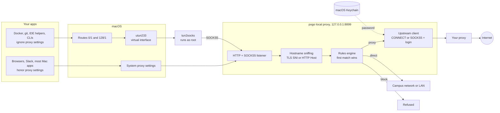
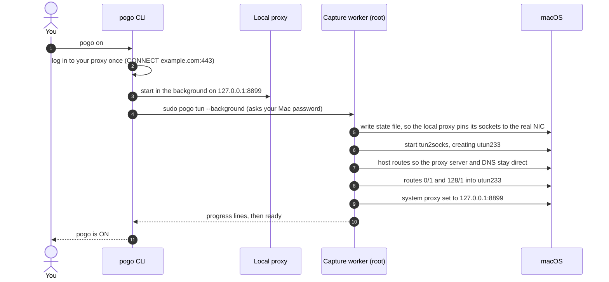
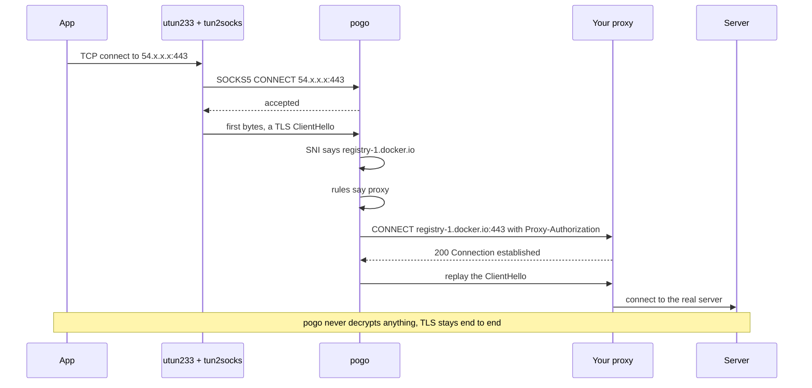
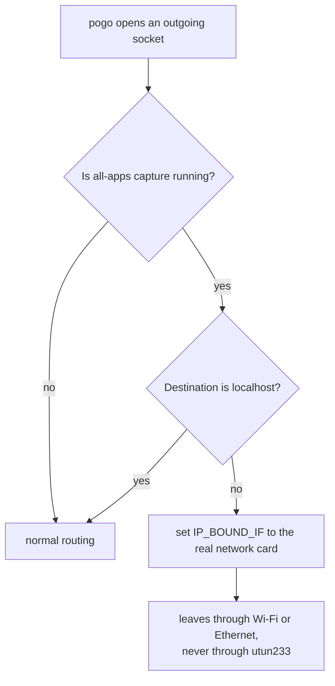
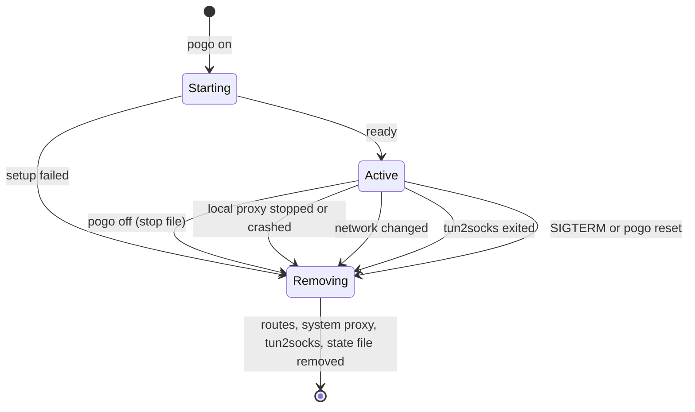

# Architecture

pogo is about 2,700 lines of dependency-free Python plus one optional open-source helper,
[tun2socks](https://github.com/xjasonlyu/tun2socks). This page explains how the pieces fit
together and why they're built that way.

- [Components](#components)
- [What `pogo on` does](#what-pogo-on-does)
- [Life of a connection](#life-of-a-connection)
- [How pogo avoids routing loops](#how-pogo-avoids-routing-loops)
- [The watchdog: how pogo cleans up](#the-watchdog-how-pogo-cleans-up)
- [Processes and files](#processes-and-files)
- [Source layout](#source-layout)

## Components

| Piece | Runs as | Job |
|---|---|---|
| **Local proxy** (`pogo/server.py`) | you | One port that speaks both HTTP-proxy and SOCKS5. Applies rules, logs in to your proxy, pipes bytes. |
| **Capture worker** (`pogo/tun.py`) | root | Starts tun2socks, installs and removes routes, sets the system proxy, watches for reasons to stop. |
| **tun2socks** | root | Turns raw packets arriving on `utun233` into SOCKS5 connections to the local proxy. |
| **CLI** (`pogo/cli.py`) | you | Everything you type. Starts and stops the other two and explains what's going on. |

## What `pogo on` does

The root part is split in two. The sudo'd process launches the long-running worker, relays its
progress to your terminal through a pipe, and exits as soon as the worker reports `ready`. So
your terminal is free again, and `pogo off` later doesn't need your password: it just creates a
stop file that the worker watches.

## Life of a connection

An app that ignores proxy settings, in all-apps mode:

Why accept first and decide later? In all-apps mode pogo only sees an IP address. To apply site
rules (and to send your proxy a hostname, which many proxies require for filtering) pogo
accepts the connection, waits up to 0.3 s for the first bytes, and reads the hostname from the
TLS Server Name Indication or the HTTP `Host` header. Protocols where the server speaks first,
like SSH, simply fall back to the IP address after that short wait.

Apps that use the system proxy skip all of this: they send `CONNECT hostname:443` straight to
pogo.

## How pogo avoids routing loops

Capturing everything has a classic trap: the proxy's *own* connections would be captured too,
and loop forever. tun2socks' own documentation warns about exactly this when its proxy runs locally.

On top of that, host routes keep the proxy server and your DNS servers on the real network, and
your own subnet already has a more specific route than `0/1` and `128/1`, so local traffic is
never captured.

On macOS a pinned socket only uses routes *scoped* to its interface, so pogo also adds a default
route scoped to the real interface (`route add -ifscope en0 default <gateway>`) while the capture
runs; without it, pinned connections would fail with "Network is unreachable". On Windows the
equivalent option, `IP_UNICAST_IF`, uses the adapter's own default route, so nothing extra is
needed. How the Windows side works in detail: [windows.md](windows.md).

## The watchdog: how pogo cleans up

The capture worker checks once a second whether it should stop, and always removes what it
added: routes first, so traffic stops entering the tunnel, then the system proxy, then
tun2socks, and the state file last.

If even the worker is killed with `kill -9`, `pogo reset` reads the list of routes the worker
recorded and removes them. Only well-formed `route delete` commands are accepted from that file.

## Processes and files

Paths are shown for macOS; on Windows the folder is `%USERPROFILE%\.pogo`.

| Path | Written by | Contents |
|---|---|---|
| `~/.config/pogo/config.json` | you, via the CLI | proxy address, port, username, rules |
| macOS Keychain item `pogo` / Credential Manager `pogo:…` | you, via the CLI | your proxy password |
| `~/.config/pogo/pogo.pid` | local proxy | its process ID |
| `~/.config/pogo/pogo.log` | local proxy | one line per connection (`pogo logs`) |
| `~/.config/pogo/tun.json` | capture worker | interface, gateway, routes it added |
| `~/.config/pogo/tun.stop` | `pogo off` | asks the worker to stop |
| `~/.config/pogo/tun.log` | capture worker | capture start/stop log |

Files the root worker writes in your (user-writable) config folder use a fresh temporary file
plus an atomic rename, or `O_NOFOLLOW`, so a planted symlink can't redirect a root write.

## Source layout

| File | Purpose |
|---|---|
| `pogo/cli.py` | commands, help texts, the overview screen, `doctor`, `reset` |
| `pogo/server.py` | the local proxy: HTTP + SOCKS5 in, CONNECT / SOCKS5 out, sniffing, piping |
| `pogo/tun.py` | all-apps capture: routes, tun2socks, watchdog, cleanup |
| `pogo/rules.py` | pattern matching and rule decisions |
| `pogo/sysproxy.py` | macOS system proxy via `networksetup` and `scutil` |
| `pogo/config.py` | config file, runtime state, Keychain |
| `pogo/proxifier_import.py` | reads Proxifier `.ppx` profiles |
| `pogo/launch.py` | relaunching pogo in the background, or with admin rights (sudo / UAC) |
| `pogo/system.py` | processes, admin rights and files: what differs between macOS and Windows |
| `pogo/helper.py` | downloads and verifies tun2socks (and Wintun on Windows) |
| `pogo/winnet.py` | Windows routing table, adapters and DNS servers (IP Helper API) |
| `pogo/winproxy.py` | Windows proxy settings (WinINet), backup and restart safety net |
| `pogo/wincred.py` | Windows Credential Manager |
| `pogo/ui.py` | colors, symbols, prompts |
