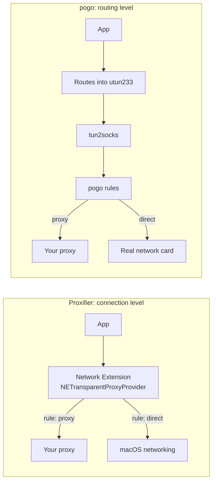

# How Proxifier routes every app, and how pogo does it

Both tools solve the same problem: making apps that know nothing about proxies use one anyway.
They hook into macOS at different layers.

## Proxifier: a Network Extension

Proxifier for Mac 3 moved from a kernel extension to Apple's Network Extension framework when
macOS Big Sur deprecated kernel extensions ([Proxifier v3 announcement][v3]). Its changelog
records adopting the `NETransparentProxyProvider` API ([changelog][changelog]). The extension
ships as a system extension that you approve in System Settings.

With a transparent proxy provider, macOS hands the extension every new outgoing connection
**before** normal routing, along with metadata such as the app that opened it
([Apple: NETransparentProxyProvider][apple-tpp]). The extension either handles the connection
itself (opening its own connection through the proxy) or returns it to macOS to go out normally
([Apple developer forums][forum-flows]). Proxifier's rules can match applications, hostnames, IP
addresses and ports, are processed top to bottom, and choose between proxy, chain, block and
direct ([features][features]).

Building such an extension needs a Network Extension entitlement on a paid Apple Developer
account ([Apple developer forums][forum-paid]).

## pogo: a virtual interface and routes

pogo can't ship an Apple-entitled extension, so it works one layer lower, at routing. This is
the same "TUN mode" approach many proxy tools use:

1. Two routes, `0.0.0.0/1` and `128.0.0.0/1`, send all IPv4 traffic into a virtual interface.
   They're more specific than the default route, so they win without replacing it.
2. [tun2socks][tun2socks] turns the packets into SOCKS5 connections to pogo's local proxy.
3. pogo applies your rules and forwards through your proxy or straight out. Its own sockets are
   pinned to the real network card so they can't loop back.
4. pogo also sets the macOS system proxy, so apps that support it send hostnames directly.

## What that means in practice

|  | Proxifier 3 | pogo |
|---|---|---|
| Where it hooks in | each new connection, before routing | IP routing (virtual interface) |
| Needs | approved system extension | admin password at `pogo on` |
| Captures | every TCP connection | every IPv4 TCP connection |
| Knows which app connected | yes | no |
| Rules by app | yes | no (on the roadmap) |
| Rules by site / IP | yes | yes |
| Hostname for rules | from the connection | system-proxy apps: given directly. Others: TLS SNI or HTTP `Host` |
| DNS | local, or through the proxy | local |
| UDP | TCP only; can block QUIC ([changelog][changelog]) | not captured; QUIC falls back to TCP |
| IPv6 | yes ([features][features]) | not captured |
| Proxy logins | Basic, NTLM, Kerberos ([features][features]) | Basic, SOCKS5 user/password |
| Proxy chains | yes | no |
| Interface | GUI | CLI |

## Importing from Proxifier

`pogo import` reads Proxifier's profile (`.ppx`) and copies:

- the proxy address, port, type and username (`HTTPS` proxies become pogo's `http`, which uses `CONNECT`)
- site and IP rules, including IP ranges like `10.1.1.0-10.1.1.255` (converted to CIDR)
- the default rule

It lists what it can't copy instead of silently dropping it: per-app rules, rules limited to
ports, proxy chains, and the rule for the proxy server itself (pogo always reaches its proxy
directly). Proxifier stores the password encrypted, so you type it once.

## Sources

- [Proxifier for Mac v3][v3]
- [Proxifier for Mac changelog][changelog]
- [Proxifier features][features]
- [Apple: NETransparentProxyProvider][apple-tpp]
- [Apple developer forums: flow metadata and returning flows to the system][forum-flows]
- [Apple developer forums: Network Extension needs a paid membership][forum-paid]
- [tun2socks wiki: examples][tun2socks]

[v3]: https://www.proxifier.com/new/mac.html
[changelog]: https://www.proxifier.com/changelog/mac.html
[features]: https://www.proxifier.com/features.htm
[apple-tpp]: https://developer.apple.com/documentation/networkextension/netransparentproxyprovider
[forum-flows]: https://developer.apple.com/forums/thread/763912
[forum-paid]: https://developer.apple.com/forums/thread/769825
[tun2socks]: https://github.com/xjasonlyu/tun2socks/wiki/Examples
