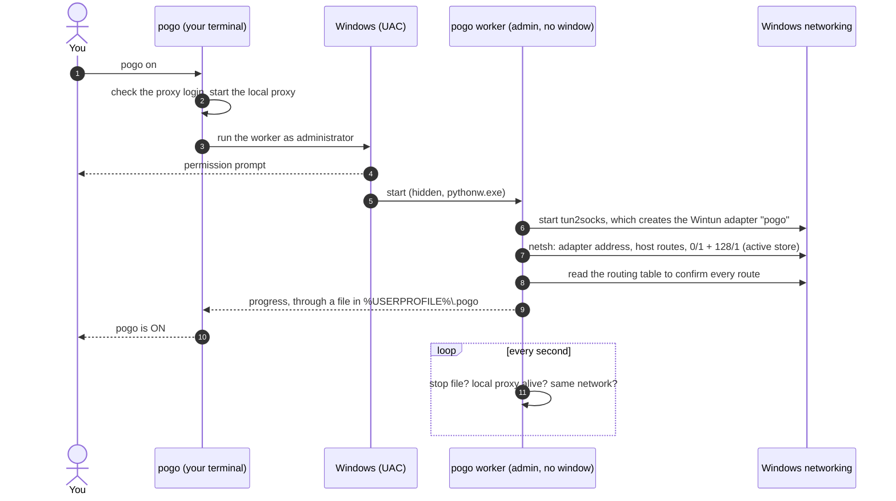

# pogo on Windows

Same commands and rules as on macOS. This page covers what's different on Windows.

- [Install](#install)
- [First run](#first-run)
- [What pogo changes on your PC](#what-pogo-changes-on-your-pc)
- [How all-apps mode works on Windows](#how-all-apps-mode-works-on-windows)
- [Windows-specific notes](#windows-specific-notes)
- [Undo everything by hand](#undo-everything-by-hand)

## Install

Open **PowerShell** (Start menu → type "PowerShell") and run:

```powershell
irm https://raw.githubusercontent.com/kharshit801/pogo/main/install.ps1 | iex
```

The installer:

- needs **no admin rights** and **no git**
- finds Python 3.9+, or offers to install it with winget (the Microsoft Store "python" placeholder doesn't count)
- puts pogo in `%USERPROFILE%\.pogo` and adds the `pogo` command to your user PATH
- can be run again at any time to update

Then open a **new** terminal window and type `pogo`. If Windows says "pogo is not recognized",
close Windows Terminal completely and open it again (it caches PATH).

> **No internet yet?** The installer downloads from GitHub. Run it while connected some other
> way (a phone hotspot), or while Proxifier is still running.

## First run

```powershell
pogo setup        # or: pogo import   (copies your Proxifier profile)
pogo test         # checks the proxy and your password
pogo on           # all apps; Windows shows a permission prompt
pogo logs -f      # watch connections (Ctrl-C to stop; answer Y if cmd asks "Terminate batch job?")
pogo off          # back to normal, no prompt
```

The first `pogo on` offers to download two helpers into `%USERPROFILE%\.pogo\bin`:

| File | From | Checked against |
|---|---|---|
| `tun2socks.exe` | [tun2socks v2.7.0 release](https://github.com/xjasonlyu/tun2socks/releases/tag/v2.7.0) | pinned SHA-256 |
| `wintun.dll` | [wintun.net](https://www.wintun.net) (0.14.1, signed by WireGuard LLC) | wintun.net's published SHA-256 |

They're downloaded through pogo's own proxy, so they work on a proxy-only network.

## What pogo changes on your PC

| Change | When | Undone by |
|---|---|---|
| Wintun network adapter called **pogo** | all-apps mode | `pogo off` (it disappears when tun2socks stops) |
| Routes `0.0.0.0/1`, `128.0.0.0/1` and a few host routes | all-apps mode | `pogo off`; they're in the *active* store, so a restart also clears them |
| Windows proxy settings | basic mode only | `pogo off` restores your previous settings; if the PC restarts while pogo is on, a one-time sign-in task (RunOnce) restores them |
| Credential Manager entry `pogo:<user>@<proxy>` | `pogo setup` / `pogo import` | `pogo uninstall`, or delete it in Credential Manager |
| Files in `%USERPROFILE%\.pogo` (the program, settings, logs, helpers) | always | `pogo uninstall`, or delete the folder |
| `%USERPROFILE%\.pogo\bin` in your user PATH | the installer | `pogo uninstall` |

All-apps mode doesn't touch the Windows proxy settings at all, so nothing about it survives a
restart. To remove pogo completely, run `pogo uninstall`: it turns pogo off first, lists what it will
remove and asks before it does. The last of the folder goes a moment after the command finishes,
because Windows can't delete `pogo.cmd` while it's still running.

## How all-apps mode works on Windows



- The worker's own progress travels through a file because an elevated process can't share a
  pipe with your (non-elevated) terminal.
- pogo's local proxy pins its outgoing connections to your real network adapter with
  `IP_UNICAST_IF`, so they never loop back into the tunnel.
- Routes and adapters are read through the IP Helper API rather than by parsing command output,
  so it works the same on every Windows language.

## Windows-specific notes

**Permission prompt.** Every `pogo on` shows one UAC prompt (unless your terminal already runs
as administrator). `pogo off` never does: it asks the worker to stop through a file.

**Antivirus and SmartScreen.** tun2socks is an open-source networking tool that isn't code-signed,
so antivirus software sometimes quarantines it right after download. pogo notices and tells you;
allow `%USERPROFILE%\.pogo\bin\tun2socks.exe` in your antivirus and run `pogo helper`.

**Group Policy.** Some managed PCs force machine-wide proxy settings
(`ProxySettingsPerUser = 0`). Basic mode can't change those; `pogo doctor` detects it. All-apps
mode doesn't need them and still works.

**Proxifier.** pogo won't force-quit Proxifier (that could leave its driver redirecting traffic
to a closed app). Exit it from its icon next to the clock when `pogo on` asks.

**Python from the Microsoft Store** works. pogo keeps its files in `%USERPROFILE%\.pogo` rather than
AppData on purpose: Store Python silently redirects AppData writes to a private folder that the
helper processes wouldn't see.

**Old consoles.** The classic Windows console font can't draw a few symbols (✔ ✖ ◐); pogo swaps
them for look-alikes there. Windows Terminal shows everything.

**Not captured:** IPv6 and UDP, as on macOS. `pogo doctor` warns if your network has IPv6.

## Undo everything by hand

`pogo reset` undoes pogo's network changes for you, and `pogo uninstall` removes pogo itself. If pogo
is broken, in an **Administrator** PowerShell:

```powershell
# capture routes (a restart also clears them)
netsh interface ipv4 delete route prefix=0.0.0.0/1 interface="pogo" store=active
netsh interface ipv4 delete route prefix=128.0.0.0/1 interface="pogo" store=active
Stop-Process -Name tun2socks -ErrorAction SilentlyContinue

# proxy settings: Settings -> Network & internet -> Proxy -> "Use a proxy server" off
Remove-Item "$env:USERPROFILE\.pogo\tun.json", "$env:USERPROFILE\.pogo\tun.stop" -ErrorAction SilentlyContinue
```
